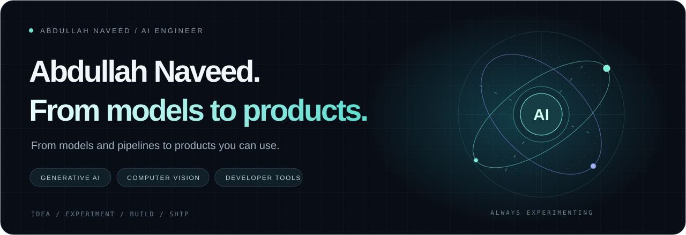
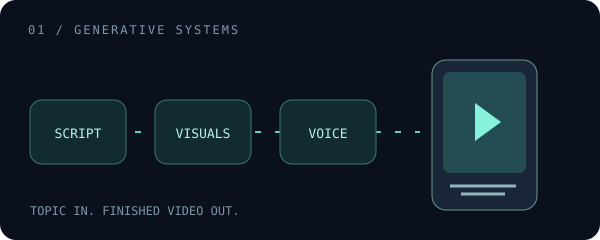
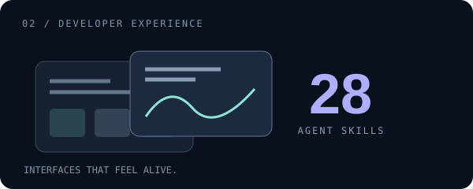
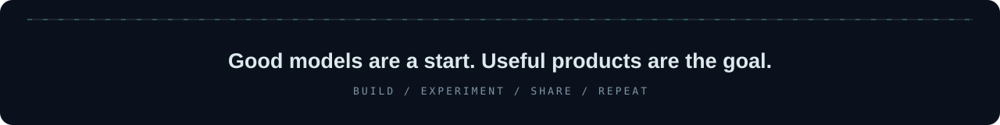

  

  <a href="#selected-builds">Selected builds</a> &nbsp; / &nbsp;
  <a href="#the-toolkit">The toolkit</a> &nbsp; / &nbsp;
  <a href="https://www.linkedin.com/in/AbdullahNaveed0007/">LinkedIn</a>

 

I'm **Abdullah, an AI engineer** working across generative AI, computer vision, and developer tools. I build the connections between models, useful workflows, and interfaces people can actually use.

**Current projects:** automated video generation and reusable frontend skills for AI coding agents.

 

## Selected builds

<table>
<tr>
<td width="50%" valign="top">

<h3>AI Shorts Generator</h3>

Turn a topic into a captioned vertical video. Scripts, generated visuals, narration, captions, and assembly in one pipeline, with a local review dashboard.

<code>Python</code> <code>OpenAI</code> <code>Flux / Wan</code> <code>FFmpeg</code>

<a href="https://github.com/AbdullahNaveed/ai-shorts-generator"><b>Explore the pipeline &nearr;</b></a>

</td>
<td width="50%" valign="top">

<h3>Frontend UX Motion Skills</h3>

28 reusable skills for coding agents. Frontend development, UI/UX, and animation guidance, each paired with a runnable example.

<code>Agent skills</code> <code>JavaScript</code> <code>CSS</code> <code>SVG</code>

<a href="https://github.com/AbdullahNaveed/frontend-ux-motion-skills"><b>Explore the skills &nearr;</b></a>

</td>
</tr>
<tr>
<td width="50%" valign="top">

03 / COMPUTER VISION

<h3>Italian Sign Language Recognition</h3>

Background augmentation, a custom CNN, ResNet18 experiments, and real-time webcam inference.

<a href="https://github.com/AbdullahNaveed/Enhanced-Real-time-Italian-Sign-Language-Recognition-with-Deep-Learning"><b>Explore the project &nearr;</b></a>

</td>
<td width="50%" valign="top">

04 / THE FOUNDATIONS

<h3>Neural Networks from Scratch</h3>

A Python implementation exploring the fundamentals beneath deep learning frameworks.

<a href="https://github.com/AbdullahNaveed/Deep-Neural-Networks-From-Scratch-Python"><b>Explore the implementation &nearr;</b></a>

</td>
</tr>
</table>

 

## A little motion. A lot of craft.

An animated look at the interface patterns in **Frontend UX Motion Skills**.

 

## The toolkit

| | Technologies |
| :--- | :--- |
| **Models & vision** | Python / PyTorch / TensorFlow / OpenCV |
| **Generative workflows** | OpenAI / Flux / Wan / Whisper / FFmpeg |
| **Interfaces & apps** | JavaScript / HTML / CSS / Flask / Flutter |
| **Engineering** | Docker / Git / Linux / C++ / C# |

 

